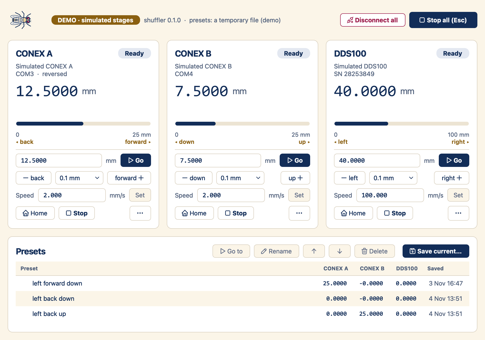

# shuffler

One window for Newport CONEX-CC and Thorlabs Kinesis stages.
Move each stage, set its speed, and save positions as presets.



## Setup

1. On the Windows rig, install [uv](https://docs.astral.sh/uv/getting-started/installation/)
   and [Thorlabs Kinesis](https://www.thorlabs.com/software-pages/Motion_Control)
   (64-bit, in `C:\Program Files\Thorlabs\Kinesis`).
2. [Download shuffler](https://github.com/gumadeiras/shuffler/archive/refs/heads/main.zip)
   and extract it. Open PowerShell in the extracted folder and run:

   ```powershell
   uv sync
   uv run shuffler-gui
   ```

The included settings are for this rig. For another rig,
[check the connections and axis settings first](docs/guide.md#hardware-on-this-rig).
Close the Newport and Kinesis applications before you connect.

After setup, double-click `shuffler.bat` to open the window.
You can also [make a desktop or taskbar shortcut](docs/guide.md#a-taskbar-icon).

## Use

- Press **Connect all**. If a stage needs homing, clear its path, then press **Home**.
- Type a target and press **Go**, or use **−** and **+** for small steps.
- Use **Save current…** to save a preset. Double-click a preset to return to it.
- Press **Stop all** or **Esc** to stop every stage, including from an open dialog.

## Try without hardware

Only uv is needed for the demo; Kinesis is not required.

```powershell
uv run shuffler-gui --demo
```

[Controls, safety, and troubleshooting](docs/guide.md) · [Development](docs/development.md)
